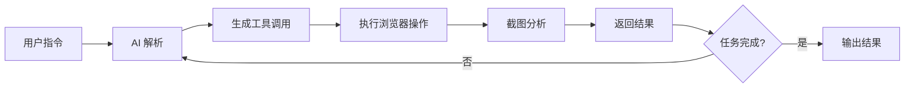

# Agent Browser

基于 Vercel AI SDK 和 Playwright 的浏览器自动化 Agent。

## 项目简介

Agent Browser 是一个 TypeScript 实现的浏览器自动化工具，使用 AI 驱动自然语言指令来控制浏览器。

**GitHub：** [vercel-labs/agent-browser](https://github.com/vercel-labs/agent-browser)

## 核心特性

- 🤖 **AI 驱动** - 使用自然语言控制浏览器
- 🎯 **智能导航** - 自动理解和执行任务
- 📸 **视觉识别** - 截图分析和元素定位
- 🔧 **工具集成** - 丰富的浏览器操作工具

## 技术栈

- **Runtime:** Node.js / Bun
- **框架:** Vercel AI SDK
- **浏览器:** Playwright
- **AI 模型:** Anthropic Claude / OpenAI GPT

## 安装

```bash
pnpm add agent-browser @ai-sdk/anthropic playwright
```

## 基础用法

### 1. 初始化 Agent

```typescript
import { anthropic } from '@ai-sdk/anthropic'
import { createAgent } from 'agent-browser'

const agent = createAgent({
  model: anthropic('claude-3-5-sonnet-20241022'),
  browser: {
    headless: false,
  },
})
```

### 2. 执行任务

```typescript
const result = await agent.run({
  instruction: '打开 GitHub，搜索 vercel，并截图前三个结果',
})

console.log(result)
```

## 高级功能

### 自定义工具

可以添加自定义工具函数：

```typescript
const agent = createAgent({
  model: anthropic('claude-3-5-sonnet-20241022'),
  tools: {
    saveData: {
      description: '保存数据到文件',
      parameters: z.object({
        filename: z.string(),
        content: z.string(),
      }),
      execute: async ({ filename, content }) => {
        await fs.writeFile(filename, content)
        return { success: true }
      },
    },
  },
})
```

### 多步骤任务

```typescript
const result = await agent.run({
  instruction: `
    1. 打开 Hacker News
    2. 找到今天最热门的三篇文章
    3. 提取标题和链接
    4. 保存为 JSON 文件
  `,
})
```

## 工作原理



## 实战示例

### 示例 1：数据采集

```typescript
const agent = createAgent({ model })

const result = await agent.run({
  instruction: `
    访问 https://example.com/products
    提取所有产品的名称、价格和链接
    保存为 CSV 格式
  `,
})
```

### 示例 2：自动化测试

```typescript
const result = await agent.run({
  instruction: `
    1. 访问登录页面
    2. 输入用户名和密码
    3. 点击登录按钮
    4. 验证是否成功跳转到首页
    5. 截图保存结果
  `,
})
```

### 示例 3：内容监控

```typescript
const result = await agent.run({
  instruction: `
    每隔 1 小时检查一次网站
    如果发现新文章，提取标题和摘要
    发送通知邮件
  `,
})
```

## 配置选项

### Browser 配置

```typescript
const agent = createAgent({
  model,
  browser: {
    headless: true, // 无头模式
    slowMo: 100, // 操作延迟（ms）
    timeout: 30000, // 超时时间
    viewport: { // 视口大小
      width: 1920,
      height: 1080,
    },
  },
})
```

### 截图配置

```typescript
const result = await agent.run({
  instruction: '访问网站并截图',
  screenshot: {
    fullPage: true, // 全页截图
    quality: 90, // 图片质量
    type: 'png', // 图片格式
  },
})
```

## 最佳实践

### 1. 清晰的指令

```typescript
// ✅ 好的指令
const result = await agent.run({
  instruction: '打开 GitHub 首页，点击右上角的 Sign in 按钮',
})

// ❌ 模糊的指令
const result = await agent.run({
  instruction: '登录 GitHub',
})
```

### 2. 错误处理

```typescript
try {
  const result = await agent.run({
    instruction: '执行任务',
    timeout: 60000,
  })
}
catch (error) {
  console.error('任务执行失败:', error)
  // 处理错误
}
```

### 3. 资源清理

```typescript
try {
  const result = await agent.run({ instruction })
}
finally {
  await agent.close() // 关闭浏览器
}
```

## 性能优化

### 1. 复用浏览器实例

```typescript
const agent = createAgent({ model })

// 执行多个任务
await agent.run({ instruction: '任务 1' })
await agent.run({ instruction: '任务 2' })
await agent.run({ instruction: '任务 3' })

// 最后关闭
await agent.close()
```

### 2. 并发控制

```typescript
import pLimit from 'p-limit'

const limit = pLimit(3) // 最多 3 个并发任务

const tasks = urls.map(url =>
  limit(() => agent.run({
    instruction: `访问 ${url} 并提取数据`,
  }))
)

const results = await Promise.all(tasks)
```

## 故障排除

### 浏览器启动失败

```bash
# 安装浏览器
pnpm exec playwright install chromium
```

### 截图模糊

```typescript
// 调整视口大小和设备缩放比
const agent = createAgent({
  model,
  browser: {
    viewport: {
      width: 1920,
      height: 1080,
    },
    deviceScaleFactor: 2, // Retina 显示
  },
})
```

## 相关资源

- [Browser Use 案例](./browser-use.md)
- [工具资源](/tools/)
- [开发指南](/guide/)
