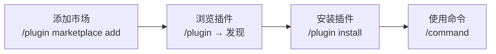

# Marketplace

> Marketplace 是插件的分发目录，提供集中式发现、版本跟踪、自动更新以及对多种源类型的支持。

## 市场工作原理

使用 Marketplace 分为两步：

1. **添加市场**：向 Claude Code 注册一个目录（此时不安装任何插件，只是浏览可用内容）
2. **安装插件**：从已注册的市场中选择并安装特定插件



## 官方市场

| 市场               | 名称                      | 说明                                                |
| ------------------ | ------------------------- | --------------------------------------------------- |
| **Anthropic 官方** | `claude-plugins-official` | 启动 Claude Code 时自动可用，由 Anthropic 维护      |
| **演示市场**       | `claude-code-plugins`     | 包含展示插件系统可能性的示例插件，由 Anthropic 维护 |

### 推荐插件

官方市场 (`claude-plugins-official`) 按用途分为以下几类，常用插件如下：

#### 开发工作流

为常见开发任务添加命令和代理的插件：

| 插件                | 说明                                                          | 安装命令                                                    |
| ------------------- | ------------------------------------------------------------- | ----------------------------------------------------------- |
| `commit-commands`   | Git 提交工作流（`/commit`、`/commit-push-pr`、`/clean_gone`） | `/plugin install commit-commands@claude-plugins-official`   |
| `pr-review-toolkit` | 用于审查拉取请求的专门代理                                    | `/plugin install pr-review-toolkit@claude-plugins-official` |
| `agent-sdk-dev`     | 使用 Claude Agent SDK 构建的工具                              | `/plugin install agent-sdk-dev@claude-plugins-official`     |
| `plugin-dev`        | 用于创建您自己的插件的工具包                                  | `/plugin install plugin-dev@claude-plugins-official`        |

#### 代码智能（LSP 集成）

使用 LSP 提供跳转定义、查找引用、类型错误检测：

| 插件           | 语言       | 需要安装                                                             |
| -------------- | ---------- | -------------------------------------------------------------------- |
| Python LSP     | Python     | `pyright-langserver` (`pip install pyright`)                         |
| Go LSP         | Go         | `gopls` (`go install golang.org/x/tools/gopls@latest`)               |
| Rust LSP       | Rust       | `rust-analyzer` (随 `rustup` 安装)                                   |
| TypeScript LSP | TypeScript | `typescript-language-server` (`npm i -g typescript-language-server`) |

::: tip 代码智能插件
代码智能插件需要在系统上安装对应的语言服务器二进制文件。安装后 Claude 可以获得跳转定义、查找引用、诊断错误等能力。
:::

#### 外部集成（MCP Servers）

捆绑预配置的 MCP 服务器，连接外部服务：

| 插件   | 连接服务   | 用途                |
| ------ | ---------- | ------------------- |
| GitHub | GitHub API | Issue、PR、仓库管理 |
| GitLab | GitLab API | 项目、MR 管理       |
| Jira   | Jira Cloud | 任务管理            |
| Linear | Linear API | 项目跟踪            |
| Notion | Notion API | 知识库、文档        |
| Figma  | Figma API  | 设计稿获取          |
| Vercel | Vercel API | 部署管理            |
| Slack  | Slack API  | 消息通知            |
| Sentry | Sentry API | 错误追踪            |

#### 输出样式

自定义 Claude 的响应方式：

| 插件                       | 说明                           |
| -------------------------- | ------------------------------ |
| `explanatory-output-style` | 教育性输出风格，添加解释性见解 |
| `learning-output-style`    | 交互式学习风格，鼓励探索       |

## 添加市场

使用 `/plugin marketplace add` 从多种来源添加市场：

```bash
# 从 GitHub 添加（最常用）
/plugin marketplace add owner/repo

# 从其他 Git 主机添加（GitLab, Bitbucket 等）
/plugin marketplace add https://gitlab.com/company/plugins.git
/plugin marketplace add [email protected]:company/plugins.git

# 指定分支或标签
/plugin marketplace add owner/repo#v1.0.0

# 从本地路径添加
/plugin marketplace add ./my-marketplace
/plugin marketplace add ./path/to/marketplace.json

# 从远程 URL 添加
/plugin marketplace add https://example.com/marketplace.json
```

## 安装插件与范围

```bash
# 默认安装（用户范围）
/plugin install plugin-name@marketplace-name

# 示例
/plugin install commit-commands@claude-plugins-official

# 指定范围安装
claude plugin install formatter@your-org --scope project
```

### 安装范围

| 安装范围             | 说明                                                     | 共享                 |
| -------------------- | -------------------------------------------------------- | -------------------- |
| **用户范围**（默认） | 在所有项目中为自己安装                                   | 不共享               |
| **项目范围**         | 为此仓库的所有协作者安装（写入 `.claude/settings.json`） | 仓库级共享           |
| **本地范围**         | 仅在此仓库中为自己安装                                   | 不共享               |
| **托管范围**         | 由管理员通过托管设置安装                                 | 组织级，用户无法修改 |

::: warning 安全提示
安装插件前，务必检查插件主页了解其功能和可信度。Anthropic 不控制第三方插件的内容。
:::

## 管理市场与插件

### 交互式管理

运行 `/plugin` 命令打开管理器，包含四个选项卡：

1. **发现** — 浏览所有已注册市场中的可用插件
2. **已安装** — 查看、启用、禁用或卸载插件（按范围分组）
3. **市场** — 添加、更新或删除市场
4. **错误** — 查看插件加载错误

### CLI 命令

```bash
# === 市场管理 ===
/plugin marketplace list             # 列出已注册的市场
/plugin marketplace update <name>    # 刷新市场列表
/plugin marketplace remove <name>    # 删除市场（同时卸载其所有插件）

# === 插件管理 ===
/plugin install <name>@<marketplace> # 安装插件
/plugin disable <name>@<marketplace> # 禁用插件
/plugin enable <name>@<marketplace>  # 启用插件
/plugin uninstall <name>@<marketplace> # 卸载插件
```

### 自动更新配置

| 场景               | 默认行为   | 环境变量                        |
| ------------------ | ---------- | ------------------------------- |
| 官方市场           | 自动更新   | —                               |
| 第三方/本地市场    | 不自动更新 | —                               |
| 完全禁用更新       | —          | `DISABLE_AUTOUPDATER=true`      |
| 仅保留插件自动更新 | —          | `FORCE_AUTOUPDATE_PLUGINS=true` |

## 创建与分发 Marketplace

创建和分发流程：

1. **创建 Plugin** — 构建包含 commands、agents、hooks、MCP/LSP servers 的插件（详见 [Plugins](./plugins)）
2. **创建 marketplace.json** — 定义市场文件，列出插件及其位置
3. **托管 Marketplace** — 推送到 GitHub、GitLab 或其他 git 主机
4. **共享与使用** — 用户 `/plugin marketplace add` 添加，`/plugin install` 安装

### `marketplace.json` 格式

Marketplace 文件位于仓库根目录的 `.claude-plugin/marketplace.json`。

#### 完整示例

```json
{
  "name": "my-team-plugins",
  "owner": {
    "name": "Your Team",
    "email": "team@example.com"
  },
  "metadata": {
    "description": "Team shared plugins for development workflow",
    "version": "1.0.0",
    "pluginRoot": "./plugins"
  },
  "plugins": [
    {
      "name": "review-plugin",
      "source": "./plugins/review-plugin",
      "description": "Adds a /review skill for quick code reviews",
      "version": "1.0.0",
      "author": { "name": "Your Name" },
      "keywords": ["review", "code-quality"],
      "category": "workflow"
    },
    {
      "name": "external-plugin",
      "source": {
        "source": "github",
        "repo": "owner/plugin-repo",
        "ref": "v2.0.0"
      },
      "description": "A plugin from another GitHub repo"
    }
  ]
}
```

#### 必需字段

| 字段      | 类型     | 说明                                                      |
| --------- | -------- | --------------------------------------------------------- |
| `name`    | `string` | Marketplace 标识符（kebab-case，无空格），如 `acme-tools` |
| `owner`   | `object` | 维护者信息，包含 `name`（必需）和 `email`（可选）         |
| `plugins` | `array`  | 可用插件列表                                              |

#### 可选元数据

| 字段                   | 说明                   |
| ---------------------- | ---------------------- |
| `metadata.description` | Marketplace 描述       |
| `metadata.version`     | Marketplace 版本       |
| `metadata.pluginRoot`  | 相对插件源路径的基目录 |

#### Plugin 条目字段

**必需：**

| 字段     | 说明                                   |
| -------- | -------------------------------------- |
| `name`   | 插件标识符                             |
| `source` | 插件来源（字符串或对象，见下方源类型） |

**可选（标准元数据）：**

`description`、`version`、`author`、`homepage`、`repository`、`license`、`keywords`、`category`、`tags`

**可选（组件配置）：**

`commands`、`agents`、`hooks`、`mcpServers`、`lspServers` — 自定义路径或配置

### Plugin 源类型

#### 相对路径

适用于同一仓库中的插件（仅限通过 Git 方式添加 marketplace 时有效）：

```json
"source": "./plugins/review-plugin"
```

#### GitHub 仓库

```json
"source": {
  "source": "github",
  "repo": "owner/plugin-repo",
  "ref": "v2.0.0",
  "sha": "a1b2c3d4..."
}
```

`ref`（分支/标签）和 `sha`（commit hash）均为可选，用于固定版本。

#### Git 仓库（非 GitHub）

```json
"source": {
  "source": "url",
  "url": "https://gitlab.com/team/plugin.git"
}
```

::: warning URL 方式的限制
通过远程 URL 添加的 marketplace 仅下载 JSON 文件本身，不会克隆仓库。因此**相对路径的 source 会失效**，需改用 GitHub/Git URL 作为外部源。
:::

### 演练：创建本地 Marketplace

```bash
# 1. 创建目录结构
mkdir -p my-marketplace/.claude-plugin
mkdir -p my-marketplace/plugins/review-plugin/.claude-plugin
mkdir -p my-marketplace/plugins/review-plugin/skills/review

# 2. 创建 Skill
cat > my-marketplace/plugins/review-plugin/skills/review/SKILL.md << 'EOF'
---
name: review
description: "Quick code review for staged changes"
---

Review the current staged changes and provide feedback.

## Instructions

1. Get the diff: `git diff --staged`
2. Analyze for bugs, security issues, style, performance
3. Report findings with file locations and suggestions
EOF

# 3. 创建 Plugin 清单
cat > my-marketplace/plugins/review-plugin/.claude-plugin/plugin.json << 'EOF'
{
  "name": "review-plugin",
  "description": "Adds a /review skill for quick code reviews",
  "version": "1.0.0"
}
EOF

# 4. 创建 Marketplace 文件
cat > my-marketplace/.claude-plugin/marketplace.json << 'EOF'
{
  "name": "my-plugins",
  "owner": { "name": "Your Name" },
  "plugins": [
    {
      "name": "review-plugin",
      "source": "./plugins/review-plugin",
      "description": "Adds a /review skill for quick code reviews"
    }
  ]
}
EOF

# 5. 安装与测试
# /plugin marketplace add ./my-marketplace
# /plugin install review-plugin@my-plugins
# /review
```

### 托管到 GitHub

```bash
cd my-marketplace
git init && git add . && git commit -m "feat: initial marketplace"
git remote add origin https://github.com/your-org/claude-plugins.git
git push -u origin main
```

用户添加：

```bash
/plugin marketplace add your-org/claude-plugins
```

## 团队市场配置

### 为团队要求 Marketplace

在仓库的 `.claude/settings.json` 中配置 `extraKnownMarketplaces`，当团队成员信任项目文件夹时，会自动提示安装指定的 Marketplace：

```json
{
  "extraKnownMarketplaces": {
    "company-tools": {
      "source": {
        "source": "github",
        "repo": "your-org/claude-plugins"
      }
    }
  },
  "enabledPlugins": {
    "code-formatter@company-tools": true
  }
}
```

### 托管 Marketplace 限制

管理员可使用 `strictKnownMarketplaces` 限制用户允许添加的 Marketplace：

| 配置值          | 效果                               |
| --------------- | ---------------------------------- |
| **未定义**      | 无限制，用户可添加任何 marketplace |
| **空数组 `[]`** | 完全锁定，无法添加新 marketplace   |
| **源列表**      | 仅允许添加匹配列表中的 marketplace |

```json
{
  "strictKnownMarketplaces": [
    {
      "source": "github",
      "repo": "acme-corp/approved-plugins"
    }
  ]
}
```

## 私有仓库认证

### 手动安装/更新

使用现有的 git 凭证助手（如 `gh auth login` 配置的凭证），直接通过 SSH 或 HTTPS 访问私有仓库。

### 后台自动更新

需在环境变量中设置认证令牌：

```bash
# GitHub
export GITHUB_TOKEN=ghp_xxxxxxxxxxxx

# GitLab
export GITLAB_TOKEN=glpat-xxxxxxxxxxxx
```

## 故障排除

| 问题                              | 解决方案                                                                    |
| --------------------------------- | --------------------------------------------------------------------------- |
| Marketplace 未加载                | 检查 URL 可访问性、JSON 语法及文件路径（`.claude-plugin/marketplace.json`） |
| Plugin 安装失败                   | 检查源 URL 访问权限、目录结构及必需文件（`plugin.json`）                    |
| 私有仓库认证失败                  | 检查 git 凭证助手配置及环境变量中的 Token                                   |
| 相对路径在 URL Marketplace 中失败 | URL 方式仅下载 JSON 文件，需改用 GitHub/Git URL 源或基于 Git 的 Marketplace |
| `/plugin` 命令无法识别            | 检查版本 >= 1.0.33（`claude --version`），更新并重启终端                    |
| 插件技能未出现                    | 清除缓存 `rm -rf ~/.claude/plugins/cache`，重启并重新安装                   |

插件自身的加载错误、LSP 二进制缺失和跨目录引用见 [Plugins — 故障排除](./plugins#故障排除)。

## 参考链接

- [Skills 目录](./skills) — 本仓库全部 Skills
- [编写 Skill](./skills/authoring) — Skill 结构与编写要点
- [Plugins](./plugins) — Plugin 创建、结构与迁移
- [发现和安装插件 — Claude Code 官方文档](https://code.claude.com/docs/zh-CN/discover-plugins)
- [创建和分发 Marketplace — Claude Code 官方文档](https://code.claude.com/docs/zh-CN/plugin-marketplaces)
