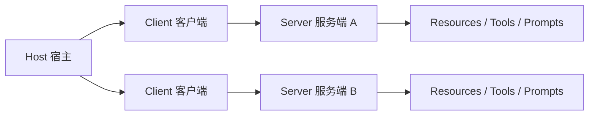

# MCP（Model Context Protocol）

[MCP（Model Context Protocol）](https://modelcontextprotocol.io/) 是一个开放协议，旨在实现 LLM 应用与外部数据源和工具之间的无缝集成。无论是构建 AI 驱动的 IDE、增强聊天界面，还是创建自定义 AI 工作流，MCP 都提供了一种标准化的方式来连接 LLM 与所需的上下文。

## 概述

MCP 提供了一种标准化方式，使应用程序能够：

- 与语言模型共享上下文信息
- 向 AI 系统暴露工具和能力
- 构建可组合的集成与工作流

协议使用 [JSON-RPC](https://www.jsonrpc.org/) 2.0 消息格式，在以下三种角色之间建立通信：

- **Host（宿主）**：发起连接的 LLM 应用（如 Claude Desktop、IDE 等）
- **Client（客户端）**：宿主应用内部的连接器
- **Server（服务端）**：提供上下文和能力的服务

MCP 的设计灵感来源于 [Language Server Protocol（LSP）](https://microsoft.github.io/language-server-protocol/)，正如 LSP 标准化了编程语言在开发工具生态中的支持方式，MCP 则标准化了 AI 应用生态中上下文和工具的集成方式。

## 核心概念

### 基础协议

- **JSON-RPC** 消息格式
- **有状态连接**（Stateful Connections）
- **能力协商**（Capability Negotiation）：Server 和 Client 在连接建立时协商各自支持的特性

### Server 提供的能力

| 能力          | 说明                               |
| ------------- | ---------------------------------- |
| **Resources** | 上下文和数据，供用户或 AI 模型使用 |
| **Prompts**   | 模板化的消息和工作流               |
| **Tools**     | 供 AI 模型执行的函数               |

### Client 提供的能力

| 能力            | 说明                                  |
| --------------- | ------------------------------------- |
| **Sampling**    | 服务端发起的 LLM 交互（agentic 行为） |
| **Roots**       | 服务端查询 URI 或文件系统边界         |
| **Elicitation** | 服务端向用户请求额外信息              |

### 辅助功能

- 配置管理（Configuration）
- 进度追踪（Progress Tracking）
- 取消操作（Cancellation）
- 错误上报（Error Reporting）
- 日志记录（Logging）

## 安全与信任

MCP 通过任意数据访问和代码执行路径实现强大的功能，但同时也带来了重要的安全考量：

1. **用户同意与控制** — 用户必须明确同意并理解所有数据访问和操作
2. **数据隐私** — 未经用户同意，不得将资源数据传输到其他地方
3. **工具安全** — 工具代表任意代码执行，必须谨慎对待
4. **LLM 采样控制** — 用户必须明确批准任何 LLM 采样请求

## 参考链接

- [MCP 官方网站](https://modelcontextprotocol.io/)
- [MCP 规范（2025-06-18）](https://modelcontextprotocol.io/specification/2025-06-18)
- [Server Prompts 规范](https://modelcontextprotocol.io/specification/2025-06-18/server/prompts)
- [MCP 规范 GitHub](https://github.com/modelcontextprotocol/specification)
- [MCP TypeScript SDK](https://github.com/modelcontextprotocol/typescript-sdk)
- [MCP Python SDK](https://github.com/modelcontextprotocol/python-sdk)
