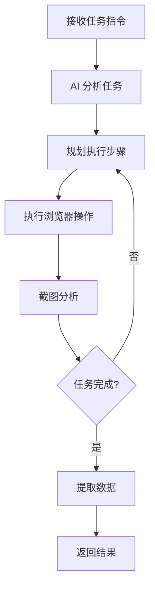

# Browser Use

Python 实现的浏览器自动化库，使用 AI 控制浏览器执行复杂任务。

## 项目简介

Browser Use 是一个 Python 库，允许使用自然语言指令来控制浏览器，适合数据采集、自动化测试等场景。

**GitHub：** [browser-use/browser-use](https://github.com/browser-use/browser-use)

## 核心特性

- 🐍 **Python 原生** - 纯 Python 实现
- 🌐 **复杂交互** - 支持复杂的网页操作
- 🤖 **AI 驱动** - Claude/GPT 驱动
- 📊 **数据提取** - 智能数据提取

## 技术栈

- **语言:** Python 3.9+
- **浏览器:** Playwright
- **AI 模型:** Anthropic Claude
- **依赖管理:** pip / poetry

## 安装

```bash
# 基础安装
pip install browser-use

# 安装 Playwright 浏览器
playwright install chromium
```

## 基础用法

### 1. 简单示例

```python
from browser_use import BrowserAgent
from anthropic import Anthropic

# 初始化客户端
client = Anthropic(api_key="your-api-key")

# 创建 Agent
agent = BrowserAgent(
    client=client,
    model="claude-3-5-sonnet-20241022"
)

# 执行任务
result = agent.run(
    "打开 Google，搜索 'Python tutorial'，截图第一页结果"
)

print(result)
```

### 2. 异步使用

```python
import asyncio
from browser_use import BrowserAgent

async def main():
    agent = BrowserAgent(client=client)
    result = await agent.run_async(
        "访问 GitHub trending 页面，提取前 10 个项目"
    )
    print(result)

asyncio.run(main())
```

## 高级功能

### 数据提取

```python
agent = BrowserAgent(client=client)

result = agent.run("""
    访问 https://news.ycombinator.com
    提取前 30 条新闻的：
    - 标题
    - 链接
    - 点赞数
    保存为 JSON 格式
""")

# result 包含提取的数据
print(result.data)
```

### 表单填写

```python
result = agent.run("""
    1. 打开 https://example.com/form
    2. 填写表单：
       - 姓名：张三
       - 邮箱：zhangsan@example.com
       - 留言：测试留言内容
    3. 点击提交按钮
    4. 等待提交成功提示
""")
```

### 多页面交互

```python
result = agent.run("""
    1. 打开商品列表页
    2. 对每个商品：
       - 点击进入详情页
       - 提取价格和描述
       - 返回列表页
    3. 汇总所有商品信息
""")
```

## 配置选项

### Agent 配置

```python
from browser_use import BrowserAgent, BrowserConfig

config = BrowserConfig(
    headless=True,           # 无头模式
    slow_mo=100,             # 操作延迟（ms）
    timeout=30000,           # 超时时间
    viewport_width=1920,     # 视口宽度
    viewport_height=1080,    # 视口高度
)

agent = BrowserAgent(
    client=client,
    config=config
)
```

### 截图配置

```python
result = agent.run(
    "访问网站并截图",
    screenshot_config={
        "full_page": True,
        "quality": 90,
        "type": "png"
    }
)
```

## 实战案例

### 案例 1：电商价格监控

```python
from browser_use import BrowserAgent
import schedule
import time

def monitor_price():
    agent = BrowserAgent(client=client)

    result = agent.run("""
        访问商品页面 https://example.com/product/123
        提取当前价格
        如果价格低于 100 元，发送邮件通知
    """)

    print(f"当前价格: {result.data.get('price')}")

# 每小时检查一次
schedule.every(1).hours.do(monitor_price)

while True:
    schedule.run_pending()
    time.sleep(60)
```

### 案例 2：自动化测试

```python
def test_login_flow():
    agent = BrowserAgent(client=client)

    result = agent.run("""
        1. 访问登录页面
        2. 输入测试账号和密码
        3. 点击登录按钮
        4. 验证是否成功登录
        5. 截图保存结果
    """)

    assert result.success, "登录测试失败"
    print("登录测试通过")

test_login_flow()
```

### 案例 3：数据采集

```python
def scrape_news():
    agent = BrowserAgent(client=client)

    all_news = []

    for page in range(1, 6):  # 采集 5 页
        result = agent.run(f"""
            访问新闻列表第 {page} 页
            提取所有新闻的标题、链接、发布时间
        """)

        all_news.extend(result.data.get('news', []))

    # 保存数据
    import json
    with open('news.json', 'w') as f:
        json.dump(all_news, f, ensure_ascii=False, indent=2)

scrape_news()
```

## 工作流程



## 最佳实践

### 1. 错误重试

```python
from tenacity import retry, stop_after_attempt, wait_exponential

@retry(
    stop=stop_after_attempt(3),
    wait=wait_exponential(multiplier=1, min=4, max=10)
)
def reliable_scrape():
    agent = BrowserAgent(client=client)
    return agent.run("执行任务")

result = reliable_scrape()
```

### 2. 资源管理

```python
from contextlib import contextmanager

@contextmanager
def browser_agent():
    agent = BrowserAgent(client=client)
    try:
        yield agent
    finally:
        agent.close()  # 确保关闭浏览器

# 使用
with browser_agent() as agent:
    result = agent.run("执行任务")
```

### 3. 日志记录

```python
import logging

logging.basicConfig(level=logging.INFO)
logger = logging.getLogger(__name__)

def monitored_task():
    logger.info("开始执行任务")
    agent = BrowserAgent(client=client)

    try:
        result = agent.run("任务指令")
        logger.info(f"任务完成: {result}")
        return result
    except Exception as e:
        logger.error(f"任务失败: {e}")
        raise
```

## 性能优化

### 1. 批量处理

```python
from concurrent.futures import ThreadPoolExecutor

def process_url(url):
    agent = BrowserAgent(client=client)
    return agent.run(f"访问 {url} 并提取数据")

urls = ["url1", "url2", "url3"]

with ThreadPoolExecutor(max_workers=3) as executor:
    results = list(executor.map(process_url, urls))
```

### 2. 缓存结果

```python
from functools import lru_cache

@lru_cache(maxsize=100)
def cached_scrape(url):
    agent = BrowserAgent(client=client)
    return agent.run(f"访问 {url} 并提取数据")
```

## 故障排除

### 问题 1：浏览器启动失败

```bash
# 重新安装浏览器
playwright install chromium --force
```

### 问题 2：元素定位失败

```python
# 增加等待时间
config = BrowserConfig(
    timeout=60000,  # 增加到 60 秒
    slow_mo=500,    # 减慢操作速度
)
```

## 相关资源

- [Agent Browser](./agent-browser.md)
- [开发工具](./dev-tools.md)
- [开发指南](/guide/)
