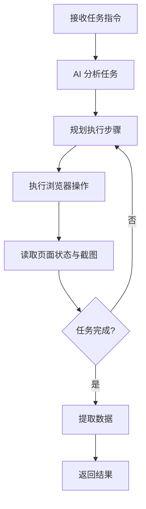

# Browser Use

Python 实现的浏览器自动化库，使用 AI 控制浏览器执行复杂任务。

## 项目简介

Browser Use 是一个 Python 库，允许使用自然语言指令来控制浏览器，适合数据采集、自动化测试等场景。

**GitHub：** [browser-use/browser-use](https://github.com/browser-use/browser-use) · **文档：** [docs.browser-use.com](https://docs.browser-use.com/)

## 核心特性

- 🐍 **Python 原生** - 纯 Python 实现，异步 API
- 🌐 **复杂交互** - 支持复杂的网页操作
- 🤖 **多模型支持** - Claude、GPT、Gemini，以及官方的 `ChatBrowserUse` 模型
- 📊 **结构化输出** - 用 Pydantic 模型约束提取结果

## 技术栈

- **语言:** Python 3.11+
- **浏览器:** Chrome / Chromium（通过 CDP 控制）
- **AI 模型:** Anthropic Claude、OpenAI、Google Gemini 等
- **依赖管理:** uv / pip

## 安装

```bash
# 推荐用 uv 创建环境
uv venv --python 3.12
source .venv/bin/activate
uv pip install browser-use # 或 pip install browser-use

# 安装 Chromium
uvx browser-use install
```

在 `.env` 中配置所用模型的 API Key，使用 Claude 时为：

```bash
ANTHROPIC_API_KEY=sk-ant-xxx
```

## 基础用法

### 1. 简单示例

```python
import asyncio

from browser_use import Agent, ChatAnthropic
from dotenv import load_dotenv

load_dotenv()  # 读取 .env 中的 ANTHROPIC_API_KEY

llm = ChatAnthropic(model="claude-sonnet-5-5")

async def main():
    agent = Agent(
        task="打开 Google，搜索 'Python tutorial'，返回第一页结果的标题",
        llm=llm,
    )
    history = await agent.run()
    print(history.final_result())

asyncio.run(main())
```

`agent.run()` 返回 `AgentHistoryList`，记录了每一步的动作、访问过的 URL 和截图，`final_result()` 取最终结果。

### 2. 同步调用

`run()` 是异步方法，脚本里不方便写 `asyncio` 时可以用 `run_sync()`：

```python
agent = Agent(
    task="访问 GitHub trending 页面，提取前 10 个项目",
    llm=llm,
)
history = agent.run_sync()
print(history.final_result())
```

## 高级功能

### 数据提取

传入 `output_model_schema`，Agent 会按 Pydantic 模型返回结构化结果：

```python
from pydantic import BaseModel

class News(BaseModel):
    title: str
    url: str
    points: int

class NewsList(BaseModel):
    items: list[News]

agent = Agent(
    task="访问 https://news.ycombinator.com，提取前 30 条新闻的标题、链接和点赞数",
    llm=llm,
    output_model_schema=NewsList,
)
history = agent.run_sync()

# structured_output 是解析好的 NewsList，没有结果时为 None
news = history.structured_output
if news:
    for item in news.items:
        print(item.title, item.points)
```

### 表单填写

```python
agent = Agent(
    task="""
    1. 打开 https://example.com/form
    2. 填写表单：
       - 姓名：张三
       - 邮箱：zhangsan@example.com
       - 留言：测试留言内容
    3. 点击提交按钮
    4. 等待提交成功提示
    """,
    llm=llm,
)
agent.run_sync()
```

### 多页面交互

```python
agent = Agent(
    task="""
    1. 打开商品列表页
    2. 对每个商品：
       - 点击进入详情页
       - 提取价格和描述
       - 返回列表页
    3. 汇总所有商品信息
    """,
    llm=llm,
)
agent.run_sync()
```

### 自定义工具

用 `Tools` 给 Agent 增加自己的动作，比如把结果写入数据库、发通知：

```python
from browser_use import ActionResult, Agent, Tools

tools = Tools()

@tools.action(description="把商品信息保存到数据库")
def save_product(name: str, price: float) -> ActionResult:
    db.insert({"name": name, "price": price})  # 替换成你的存储逻辑
    return ActionResult(extracted_content=f"已保存 {name}")

agent = Agent(task="采集商品列表并逐个保存", llm=llm, tools=tools)
```

## 配置选项

### 浏览器配置

```python
from browser_use import Agent, Browser

browser = Browser(
    headless=True,                                # 无头模式（默认按是否有显示器自动判断）
    window_size={"width": 1920, "height": 1080},  # 窗口大小
    user_data_dir="./browser-profile",            # 保留 Cookie 等登录态；None 为无痕模式
    allowed_domains=["*.example.com"],            # 只允许访问这些域名
)

agent = Agent(
    task="...",
    llm=llm,
    browser=browser,
)
```

想直接用本机 Chrome 的登录态，可以用 `Browser.from_system_chrome()`（需要先完全退出 Chrome）。

### Agent 配置

```python
agent = Agent(
    task="...",
    llm=llm,
    use_vision=True,         # 把截图发给模型（默认 True；"auto" 为按需截图）
    max_actions_per_step=5,  # 每步最多执行的动作数
    flash_mode=False,        # True 时跳过思考与评估，速度更快
    generate_gif=True,       # 把执行过程保存为 GIF
)

history = agent.run_sync(max_steps=50)  # 最多执行 50 步（默认 500）
print(history.screenshot_paths())       # 每一步的截图路径
```

## 实战案例

### 案例 1：电商价格监控

```python
import time

import schedule
from browser_use import Agent
from pydantic import BaseModel

class Price(BaseModel):
    price: float

def monitor_price():
    agent = Agent(
        task="访问商品页面 https://example.com/product/123，提取当前价格（单位：元）",
        llm=llm,
        output_model_schema=Price,
    )
    result = agent.run_sync().structured_output

    if result:
        print(f"当前价格: {result.price}")
        if result.price < 100:
            notify(f"降价了：{result.price} 元")  # 替换成邮件、IM 等通知

# 每小时检查一次
schedule.every(1).hours.do(monitor_price)

while True:
    schedule.run_pending()
    time.sleep(60)
```

### 案例 2：自动化测试

```python
import os

def test_login_flow():
    agent = Agent(
        task="""
        1. 访问 https://example.com/login
        2. 用户名填 test_user，密码填 test_password
        3. 点击登录按钮
        4. 验证页面是否出现"退出登录"按钮
        """,
        llm=llm,
        # 模型只看到占位符 test_password，看不到真实值
        sensitive_data={"test_password": os.environ["TEST_PASSWORD"]},
        browser=Browser(allowed_domains=["example.com"]),
    )

    history = agent.run_sync()

    # is_successful() 是 Agent 的自我判断，关键结果最好再用接口或数据库核对
    assert history.is_done() and history.is_successful(), "登录测试失败"
    print("登录测试通过")

test_login_flow()
```

### 案例 3：数据采集

```python
import json

from pydantic import BaseModel

class Article(BaseModel):
    title: str
    url: str
    published_at: str

class ArticleList(BaseModel):
    items: list[Article]

def scrape_news():
    all_news = []

    for page in range(1, 6):  # 采集 5 页
        agent = Agent(
            task=f"访问新闻列表第 {page} 页，提取所有新闻的标题、链接、发布时间",
            llm=llm,
            output_model_schema=ArticleList,
        )
        result = agent.run_sync().structured_output
        if result:
            all_news.extend(item.model_dump() for item in result.items)

    # 保存数据
    with open("news.json", "w") as f:
        json.dump(all_news, f, ensure_ascii=False, indent=2)

scrape_news()
```

## 工作流程



## 最佳实践

### 1. 错误重试

Agent 自带失败重试，`ChatAnthropic` 也会自动重试 API 错误，一般不需要再包一层：

```python
from browser_use import Agent, ChatOpenAI

agent = Agent(
    task="执行任务",
    llm=llm,
    max_failures=3,  # 单步出错时最多重试 3 次（默认 5）
    fallback_llm=ChatOpenAI(model="gpt-6-astra"),  # 主模型限流或报错时切换的备用模型
)

history = agent.run_sync()

if history.has_errors():
    print(history.errors())
```

### 2. 资源管理

Agent 结束时会自动关闭它启动的浏览器。多个任务要复用同一个浏览器时，设置 `keep_alive=True`，最后手动关闭：

```python
import asyncio

from browser_use import Agent, Browser

async def main():
    browser = Browser(keep_alive=True)
    try:
        await Agent(task="登录后台", llm=llm, browser=browser).run()
        await Agent(task="导出本月报表", llm=llm, browser=browser).run()
    finally:
        await browser.kill()  # 确保关闭浏览器

asyncio.run(main())
```

### 3. 日志记录

```python
import logging

logging.basicConfig(level=logging.INFO)
logger = logging.getLogger(__name__)

async def log_step(agent: Agent):
    urls = agent.history.urls()
    logger.info(f"第 {agent.state.n_steps} 步完成，当前页面：{urls[-1] if urls else '-'}")

async def monitored_task():
    logger.info("开始执行任务")
    agent = Agent(task="任务指令", llm=llm)

    try:
        history = await agent.run(on_step_end=log_step)
        logger.info(f"任务完成: {history.final_result()}")
        return history
    except Exception as e:
        logger.error(f"任务失败: {e}")
        raise
```

## 性能优化

### 1. 批量处理

每个 Agent 默认会启动自己的浏览器，可以用 `asyncio.gather` 并发执行：

```python
import asyncio

async def process_url(url: str):
    agent = Agent(task=f"访问 {url} 并提取数据", llm=llm)
    history = await agent.run()
    return history.final_result()

async def main():
    urls = ["url1", "url2", "url3"]
    return await asyncio.gather(*(process_url(url) for url in urls))

results = asyncio.run(main())
```

### 2. 缓存结果

```python
from functools import lru_cache

@lru_cache(maxsize=100)
def cached_scrape(url: str) -> str | None:
    agent = Agent(task=f"访问 {url} 并提取数据", llm=llm)
    return agent.run_sync().final_result()
```

## 故障排除

### 问题 1：浏览器启动失败

```bash
# 重新安装 Chromium
uvx browser-use install
```

也可以改用本机已安装的 Chrome：`Browser(executable_path="/Applications/Google Chrome.app/Contents/MacOS/Google Chrome")`。

### 问题 2：页面没加载完就开始操作

```python
# 放慢节奏，等页面和网络请求稳定后再读取状态
browser = Browser(
    minimum_wait_page_load_time=1.0,           # 读取页面前至少等待的秒数（默认 0.25）
    wait_for_network_idle_page_load_time=2.0,  # 等待网络空闲的秒数（默认 0.5）
    wait_between_actions=0.5,                  # 动作之间的间隔秒数（默认 0.1）
)
```

## 相关资源

- [Agent Browser](./agent-browser.md)
- [开发工具](./dev-tools.md)
- [开发指南](/guide/)
